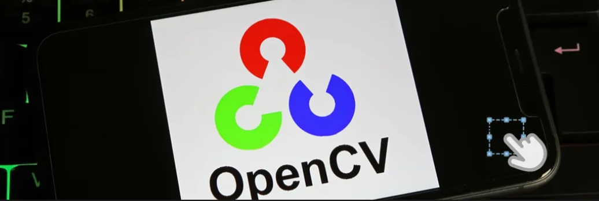
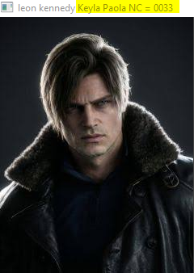
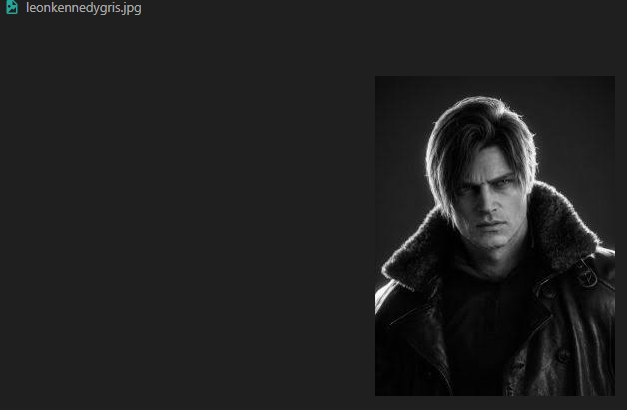
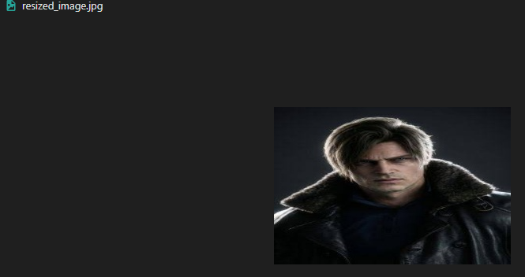
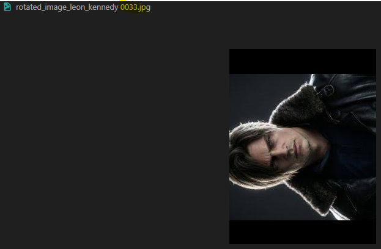
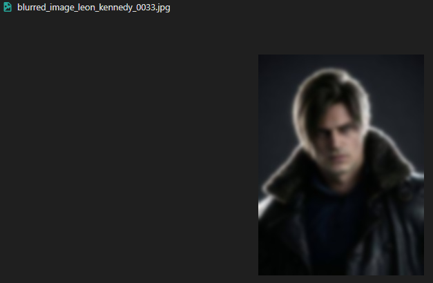
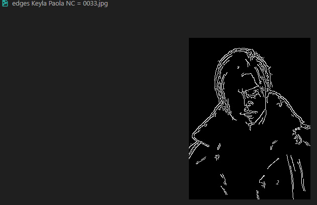
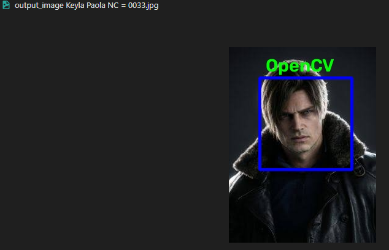
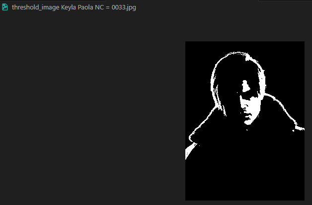
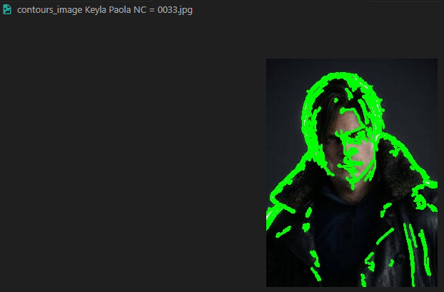

## UIII Act 5 OpenCV Practica Alumno
## Keyla Paola NC = 0033
## Procesamiento de imágenes con OpenCV

## 2. Lectura y visualización de imágenes

## 3. Conversión entre espacios de color

## 4. Cambiar el tamaño de una imagen

## 5. Rotar una imagen

## 6. Desenfoque de una imagen

## 7. Detección de bordes mediante el algoritmo de Canny

## 8. Dibujar formas y añadir texto

## 9. Umbralización

## 10. Detección de contornos
